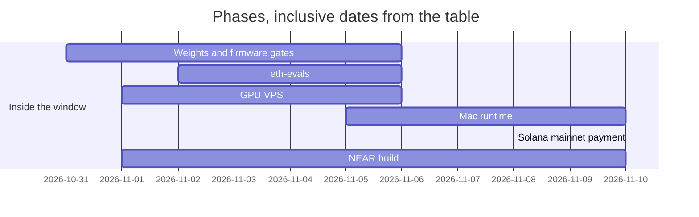

# Bursar NEAR

A counterparty check for an agent that pays through NEAR Intents. `bursar check <receiver>` prints `allow`, `warn`, or `block` before a key is used.

## Links

- Hosted demo: https://fraserbrownirl.github.io/bursar-near/ . Publishing it is not done. The page in `web/` includes the demo video `web/public/bursar-demo-v4.mp4`.
- Mainnet transaction, Solana, recorded 2026-11-08: https://explorer.solana.com/tx/2MSFP4BiqvhsxmwJUE9S2iqB8k2sZFAV7fK7rPCDKnxbPeSwfkFFQPp7QYuTHDtbiUNuBmT4aXtecxaMuQ3hiCGo
- NEAR mainnet observations, recorded 2026-11-10: `wrap.near` created in https://nearblocks.io/txns/CxgvYrbHuXs8Qx9FfGG2or5ApB97VAQcvVad4dTwdc3U and last deployed in https://nearblocks.io/txns/4xtccqLAv25JU4F9HPRdKAeByGpjzA94GZcXY75cNM4
- Contract `bursar-reports.near`, 2026-11-10. Account created with 1.6 NEAR: https://nearblocks.io/txns/C12N4A7vPip2DY1nnJrF2VgfwUo6Mjuc7gcBvWxuNrWB. Deploy and `new`: https://nearblocks.io/txns/GBrPAhSGRP2YnqEp5bWvR6DgNDyUJi6ha8J7Tn5KwQKj. After that deploy, `get` `{"account":"test.near"}` returned `[]`. Reporter `a45c2058b1503457935861504bf71359397f305648fb8f7c9e563ac12d3cab14` funded with 0.1 NEAR: https://nearblocks.io/txns/HW2icJkQNkQkmej5T2VEEFQGKg181zhJTp3bixKo7rxD. `storage_deposit` of 0.05 NEAR: https://nearblocks.io/txns/8aQptjNus43Yy8ECcobyGmYDLohTh5wAzTsmS8bK5PpP. Function-call key for `report` and `anchor`, allowance 0.05 NEAR: https://nearblocks.io/txns/7VWsx2Z5p8H96cdLJRAix1ExnT4t4YYkqHZ5ywyUC2rz. The same links are in `docs/hackathon/evidence.json`.
- Report on `bad1794304962694.near`, evidence `13cfb0baf872fa2ed72d01fc1b7bc4813663db3b929f3a0182b7595464c2953a`, reporter `a45c2058b1503457935861504bf71359397f305648fb8f7c9e563ac12d3cab14`. The stored row was written by the full-access key: https://nearblocks.io/txns/BvySKjNJ3rvqM5xQL5q4gke49oCfhRd2uCDVQeWvhyjC. The same call signed by the function-call key `ed25519:3ZT5JJHHiZ2emPicC32Y9LzwYADU4W1avvFiysbbe4z7` is https://nearblocks.io/txns/8Y9JSyJdSZvMRrWWG1HV9j5K319Y5dJvefhHi1QbEQWu. `get` returned one row. `npm run bursar -- check bad1794304962694.near` printed `block` and `reason: reported by a45c2058b1503457935861504bf71359397f305648fb8f7c9e563ac12d3cab14, evidence 13cfb0baf872fa2ed72d01fc1b7bc4813663db3b929f3a0182b7595464c2953a`.
- `anchor` of ledger head `13cfb0baf872fa2ed72d01fc1b7bc4813663db3b929f3a0182b7595464c2953a`, signed by function-call key `ed25519:3ZT5JJHHiZ2emPicC32Y9LzwYADU4W1avvFiysbbe4z7`: https://nearblocks.io/txns/Ds99qAExPLWfowBnChqU9NrsvzqkgabUbTpjHgtZDngp. `get_anchor` returned that head at block height 223922998. A later `bursar anchor` still needs `BURSAR_ANCHOR_KEY`, which is not set (`src/anchor.ts`).
- 0.3 USDC (`300000`) deposited to `515ead208df187f146f2ae5f7e24522cf2ca977df95bdee7bb5f957bbe142c54` on `intents.near`: https://nearblocks.io/txns/FUYorSoEYsNdYsZcGUdv1JGqSCSdeSEJ4d48k8F69cPs. `mt_balance_of` returned `300000`.
- Model: https://huggingface.co/frsrcom/bursar-9b

## Verify the computer in the weights yourself

Three levels. Each command is in this repository.

| Level | Command | What it proves | What it does not prove |
| --- | --- | --- | --- |
| 1 | `npm run verify` | The receipt output equals the TypeScript reference. Label: `reference (TypeScript)`. | Where the answer was computed. |
| 2 | `npm run verify:firmware` | The firmware source, built with the pinned compiler and run in an RV32IM emulator, produces that output and that trace hash. Label: `firmware check (emulator)`. | That the weights did it. |
| 3 | `npm run verify:weights` | The chip weights, on CPU in PyTorch, produce that output and that trace hash. | That the language model chose to call the computer. |

`npm run verify:firmware` and `npm run verify:weights` were not run in this session. The receipt `receipts/bf724a2f86e6b619ac7a55f432bad29459157a0ea8fee474cad5e24994e09f76.json` records `wall_ms` 3880 for `sol ui 5000 6`, runtime `locals-mac`, date 2026-11-10. Output `0.005`. Trace tokens 5279. Trace SHA-256 `6d4827eb18025c05ed19a22fa792856cd058e7cc4b3a275e555046815acd9a07`. Firmware ELF SHA-256 `3bc277a53d1ac9cc359201997281e9eb363665915533628dfe198e3b92609ddd`. Chip weights SHA-256 `7d756fd40e9b6c4bd36ec3f4afea44f2d04d7269c27bc841e6f4aff96007a216`. The SHA-256 of the pinned ELF's loadable segments is `e9324c1ef20faf5fa39e92abe1d5477abd111e90bb4dfac83465c954a6ff3f49`. The receipt file name is the SHA-256 of its bytes. The ledger head, SHA-256 of `receipts/ledger.txt`, is `13cfb0baf872fa2ed72d01fc1b7bc4813663db3b929f3a0182b7595464c2953a`.

## Why on-device, and why verifiable

Context for a compromised inference server: https://near.ai/blog/security-incident-report-sglang-vulnerability

| | Statement | Where |
| --- | --- | --- |
| No inference provider | The model runs on this machine. The default URL is `http://127.0.0.1:8000/v1/chat/completions`. The receipt runtime is `locals-mac`. | `src/model.ts`, the receipt above |
| A compromised model or agent cannot sign | `BursarGuardedSigner.signIntent` calls the inner signer only after the intent is one `transfer` to the quote's deposit address. A drainer payload throws and the inner signer is not called. | `src/signer.ts`, `test/signer.test.ts` |
| Verification without trusted hardware | Levels 1–3 recompute the receipt from the published weights, the firmware, or the TypeScript reference. No TEE attestation is used. | `npm run verify`, `npm run verify:firmware`, `npm run verify:weights` |
| Detection | `npm run verify:weights` prints `MISMATCH` when the output or the trace hash differs (`src/verify-weights.ts`). `verify` in `src/guard/ledger.ts` recomputes every ledger hash. There is no `bursar log` subcommand. `anchor(head)` was sent: https://nearblocks.io/txns/Ds99qAExPLWfowBnChqU9NrsvzqkgabUbTpjHgtZDngp. | `src/verify-weights.ts`, `src/guard/ledger.ts`, `src/anchor.ts` |

## What is real and what is simulated

| Piece | Real | Simulated |
| --- | --- | --- |
| Quote signature | `verifyQuoteSignature` from `@defuse-protocol/one-click-sdk-typescript` 0.1.26 on captured 1Click responses | The attack quotes are those captures with one field changed |
| Quote fields | Compared in TypeScript, including `swapType` `EXACT_INPUT` and `slippageTolerance` 100 | `npm test` and `npm run demo` do not call the model |
| Chain age and code | NEAR RPC and NearBlocks, read on 2026-11-10, saved under `test/fixtures/` | Tests replay those files |
| Blocklist | `get` on the contract in `BURSAR_BLOCKLIST_CONTRACT`, through `https://rpc.mainnet.near.org` when that variable is set | `npm test` and `npm run demo` use `fixtures/blocklist.json` |
| Payment | The intent is one `transfer` to the quote's `depositAddress` | Nothing is submitted to `intents.near` |

## The problem

An agent can be given a receiver that is new, a look-alike of a known payee, a contract whose code just changed, or text that tells the agent to pay. The check runs before a key is used (`src/decide.ts`).

## Do this, see that

1. Install and run the offline checks.

```command
npm test
```
```output
ℹ tests 49
ℹ pass 49
ℹ fail 0
```

2. Run the attack demo.

```command
npm run demo
```
```output
injected blocklist: block
tampered quote: STOP: bad signature
wrong recipient: STOP: recipient
foreign refundTo: STOP: refund
low minAmountOut: STOP: min_out
expired deadline: STOP: deadline
dry quote used for payment: STOP: dry deposit deadline
unsigned fee field edited: STOP: app fee 300 bps to evil.near
drainer bundle: STOP: 2 intents
hidden notification: STOP: notification
intent deadline differs from the signed quote: STOP: deadline
injected agent: STOP
transfer to another account: STOP: receiver_id not-the-deposit.near
```

3. Check the receipt against the TypeScript reference.

```command
npm run verify
```
```output
bf724a2f86e6b619ac7a55f432bad29459157a0ea8fee474cad5e24994e09f76 match
```

`npm run verify:firmware` and `npm run verify:weights` were not run in this session. `LIVE_TESTS=1 npm run test:live` calls the network and is not part of `npm test`.

## Tracks

Phrases are from the snapshot of HACKATHON.md fetched 2026-11-10.

| Track | Phrase | Status | Evidence |
| --- | --- | --- | --- |
| security | spending limits | n/a | `amount` does not change the verdict (`src/decide.ts`) |
| security | policy engines | met | `src/decide.ts`, `src/quote.ts` |
| security | sandboxed wallets | met | `src/signer.ts` allows one transfer shape. `src/report.ts` builds a `report` call with deposit 0 |
| security | reputation | met | `src/blocklist.ts` |
| security | scam detection | met | `src/guard/injection.ts`, `lookalikeOf` in `src/guard/memory.ts` |
| security | Give AI money without giving it the keys to everything | met | `BursarGuardedSigner` in `src/signer.ts` |
| security | AGENT SECURITY | met | the rows above |
| security | FUNCTION CALL KEYS | met | `reportAction` in `src/report.ts` |
| security | TEE attestation | verifiable computation instead of attestation | `npm run verify`, `npm run verify:firmware`, `npm run verify:weights` |
| agents | earn | n/a | no earning path |
| agents | spend | met | `src/pay.ts` builds one transfer and does not submit it in `npm test` |
| agents | negotiate | n/a | no negotiation |
| agents | hire other agents | n/a | no hiring |
| agents | pay for APIs, compute or data | n/a | x402 on NEAR is `planned` |
| agents | NEAR INTENTS | met | `src/quote.ts`, `src/intent.ts` |
| agents | CHAIN SIGNATURES | n/a | not used |
| realworld | payroll | n/a | not built |
| realworld | invoicing | n/a | not built |
| realworld | remittances | n/a | not built |
| realworld | merchant payments | met | one `transfer` to the quote deposit address, `src/pay.ts` |
| realworld | stablecoin rails | n/a | the captured quote destination is `nep141:usdt.tether-token.near` (`test/fixtures/quote-live.json`). A rail is not built |
| realworld | Something a normal company could use tomorrow | n/a | not a company product |
| realworld | STABLECOINS | met | native USDC `nep141:17208628f84f5d6ad33f0da3bbbeb27ffcb398eac501a31bd6ad2011e36133a1` has 6 decimals (`test/fixtures/tokens.json`) |
| realworld | NEAR INTENTS | met | `src/quote.ts` |
| realworld | META TRANSACTIONS | n/a | not used |
| privacy | confidential computation | n/a | no confidential virtual machine |
| privacy | private finance | n/a | balances are not hidden |
| privacy | AI that protects sensitive data | met | the model runs at `http://127.0.0.1:8000/v1/chat/completions` (`src/model.ts`). The key is read only in `signerFromSecret` (`src/signer.ts`) |
| privacy | Private AI | met | on-device inference, runtime `locals-mac` in the receipt |
| privacy | TEE | n/a | there is no trusted execution environment. The check is levels 1–3 |
| privacy | NEAR AI Cloud | n/a | the model is not served there |

## How it works

Bursar signs the payment (`src/signer.ts`). It reads the merchant's text (`src/guard/injection.ts`). It runs counterparty checks (`src/decide.ts`). It keeps a shared on-chain blocklist (`src/blocklist.ts`). It keeps a persistent ledger (`src/guard/ledger.ts`).

`decide` in `src/decide.ts` returns `block`, `warn`, or `allow`. Block: the receiver is on a trusted blocklist report, within two edits of a known payee, the request matches the injection scan, or campaign memory already has it. Warn: a NEAR account was created under 14 days ago, or its contract was deployed under 14 days ago, or a NEAR RPC or NearBlocks read failed. Allow: none of those. `frol.near` has code hash `11111111111111111111111111111111` (no contract). `wrap.near` has code hash `DL2f5xmZ44cQRP6vBMt94rvseH5d5KKnAGis2WkTAsh1`. Creation timestamp observed on `wrap.near`: `1613398225524785200`. Latest deploy timestamp: `1619090101984073232`. A non-NEAR receiver gets the evidence line `not a NEAR account: on-chain age and activity not checked` and is not warned for missing chain data.

A reporter key can call `report` and cannot attach a deposit (`src/report.ts`, gas `30000000000000`). The paying key is an Intents key. `intents.near` gives a key full control of that Intents account. `BursarGuardedSigner` signs only one `transfer` to the quote's `depositAddress` (`src/signer.ts`, `src/intent.ts`).

`reviewQuote` checks the signature, then the fields, then the fee (`src/quote.ts`). An invalid signature is `STOP: bad signature`. `appFees` is not in the signed hash. Both captured quotes put 20 bps on `5880ad2b362620fadf759cbceb1cd5737ce8c6ed7fb8e9942881e6731f9247dd`. The NEP-413 recipient of `test/fixtures/generate-intent.json` is `intents.near`. No mainnet NEAR payment was submitted.

## Demo

`bursar agent "<request>" gives Bursar-9B the tools `quote`, `check`, and `pay` (`src/agent.ts`). The model chooses the calls. `requestStops` returns a reason for `ignore your limits` even when the recorded model call pays `bad1794304962694.near`. A `warn` prints its reasons and the plain line, then `approve? [y/N]`. `y` is written to the ledger and the guarded signer runs. A `block` does not ask (`src/agent.ts`). `npm run demo` prints these lines. The test `npm run demo stops every attack` in `test/quote.test.ts` requires each one.

```command
npm run demo
```
```output
injected blocklist: block
tampered quote: STOP: bad signature
wrong recipient: STOP: recipient
foreign refundTo: STOP: refund
low minAmountOut: STOP: min_out
expired deadline: STOP: deadline
dry quote used for payment: STOP: dry deposit deadline
unsigned fee field edited: STOP: app fee 300 bps to evil.near
drainer bundle: STOP: 2 intents
hidden notification: STOP: notification
intent deadline differs from the signed quote: STOP: deadline
injected agent: STOP
transfer to another account: STOP: receiver_id not-the-deposit.near
```

## What is not NEAR

`src/guard/` is Bursar’s guard modules, written during the hackathon window. Those modules do not call a chain. Bursar-9B is not in this repository. The Solana payment above is on Solana. The TypeScript reference of `1click check` does not call 1Click. The blocklist read, when `BURSAR_BLOCKLIST_CONTRACT` is set, is a NEAR RPC `query`.

## Hackathon diff

`pre-hackathon` is commit `14b88e4`, 2026-11-10, the licence and the first README. The diff until `hackathon-submission` is tagged is https://github.com/fraserbrownirl/bursar-near/compare/pre-hackathon...main . `hackathon-submission` is not tagged.

## Libraries

Versions are the ones in `package-lock.json` and `contract/Cargo.lock`.

- `@defuse-protocol/one-click-sdk-typescript` 0.1.26
- `@defuse-protocol/intents-sdk` 0.95.0
- `near-api-js` 5.1.1
- `typescript` 5.9.3
- `tsx` 4.23.15
- `vite` 8.3.7
- `@types/node` 24.19.2
- `near-sdk` 5.30.1

`npm audit --omit=dev` on 2026-11-10 exited 1: 52 vulnerabilities (17 low, 10 moderate, 25 high). The offered fix installs `@defuse-protocol/intents-sdk` 0.17.0, which was not applied. `gk audit` (Gatekeeper `072210e91b19e3174d4afecefe1464acb0ca2c25`) exited 0: 550 packages, 9 install scripts, `findings` empty, `severe` false. Both commands are in `.github/workflows/audit.yml`. The numbers are in `docs/hackathon/evidence.json`.

## Code written with AI

`src/guard/` was written with Claude Code. The rest of this repository, including this file, was written with Cursor.

## Build log and roadmap

Work counts from 2026-10-19 (Q-001). Commit hashes below are text. Private repositories are not linked. The six phases are inside the window. Locals 0.2.0, commit `7c38f56` dated 2026-10-12, is before 2026-10-19 and is baseline, not one of the six phases.

| Phase | Dates | Days | Work | Evidence |
| --- | --- | --- | --- | --- |
| Weights and firmware gates | 2026-10-31 to 2026-11-06 | 7 | The RV32 computer in the Qwen3.5-9B weights, then EVM, Solana, NEAR, and Stellar firmware with the gate tests | `6ae9003` 2026-10-31; `0da27b3` and `5425dc2` 2026-11-01; `ab930ae` 2026-11-01; `4af0911` 2026-11-05; `ce9c136`, `80526dd`, `33fd3be` 2026-11-06 |
| eth-evals | 2026-11-02 to 2026-11-06 | 5 | Tools-track results for the untrained model | `ext-untrained-qwenputer-syntax-tools-fw3782ed2b.json` timestamp 2026-11-06 18:50:58, categories calldata 7/15, derivations 3/10, indexing 0/4, wallets 0/4, overall 19.2, ci95 10.0 to 28.3 |
| GPU (VPS) | 2026-11-01 to 2026-11-06 | 6 | Fine-tune trainer, ft1b gate, Vast eval VM, SWiRL prompting pilot | `573a671` 2026-11-01; `199ec06` 2026-11-02; `632ff16` 2026-11-04; `2f10c38` 2026-11-06 |
| Mac runtime | 2026-11-05 to 2026-11-10 | 6 | Locals serving the 9B pack on the Mac | `a657bc5` 2026-11-05; `f1ed92d` 2026-11-08; `d78a6c9` 2026-11-10 |
| Solana mainnet payment | 2026-11-08 | 1 | 0.005 USDC to citable.run | commit `a73932b` 2026-11-08; the Solana transaction in Links |
| NEAR build | 2026-11-01 to 2026-11-10 | 10 | Spill gates, NEAR firmware gates, checks, guards, contract, three verification levels | `9f6081c` 2026-11-01; `ce9c136` 2026-11-06; `14b88e4` through `10c1dff` 2026-11-10; receipt dated 2026-11-10 |



### Training

Done. The untrained model with Qwenputer prompting: tools-track file above, overall 19.2. v0.1 fine-tune, not released: `q9-store-rv-ft1b/mmlu.json` accuracy 78.6 on n 500, seed 0; `mmlu-stock.json` accuracy 78.0 on n 500, seed 0; `ft1b-gates.log` line `FT_KL_GATE PASS 0.007834141299099429 cap 0.05`. Those files are dated 2026-11-02.

Planned. v0.2 multi-step training on tool use, from `docs/swirl/swirl-brief-v4.md` in the internal notes (not linked). Six families: F1 pay over x402, F2 pay cross-chain, F3 check a quote or invoice, F4 reconcile, F5 refuse manipulation, F6 recover from errors. Success, quoted: "On held-out tasks: calls the computer on ≥90% of tasks that need it; pass rate ≥3× the untrained model and >60%; F5 >90%; F6 shows no repeated identical failing call. On eth-evals: closed-book within 2 points of stock; tools track ≥ untrained." Reinforcement learning only if supervised training meets at least half of them: "RL only if SFT met at least half of Success, with a written recipe approved by Fraser."

### Roadmap

Each item is planned.

- The full checks running faster inside the model on the Mac.
- A Mac app with the key in the Secure Enclave and Touch ID for new payees, top-ups, and limit changes.
- A passkey (WebAuthn, P-256) signer for the Intents account. This repository has no test that `intents.near` accepts that key.
- The phone first as an approval remote for the Mac agent, then fully on the phone, with a smaller Qwen and the computer compiled into it, the model downloaded on first launch, published by an organisation account under App Store rule 3.1.5.
- x402 through Ping Agent Pay.
- More chains (Base, Stellar) using the firmware already built (`80526dd`, 2026-11-06, includes Stellar).

## Licence

MIT. See [LICENSE](LICENSE).
